# SAR-Sim Quick Start

SAR-Sim offers two complete ways to prepare and run the same simulation model:

- **Unity Editor workflow** — use standard Inspectors and the Scene view for topology, route, traffic-flow, parameter, single-run, and batch-experiment work, and optionally stream the result into Unreal Engine / AirSim.
- **Packaged Windows workflow** — use the guided desktop workbench for the same authoring, simulation, and analysis capabilities without installing Unity.

The two interfaces share the same scenario files, route-demand services, simulation configuration, parameter catalog, batch runner, history format, and result tables. Unity additionally provides source debugging, tests, build tools, and the joint simulation; these are not simulation-capability differences.

> The red badges and the numbered legend below each screenshot identify the controls to use. They are documentation annotations and are not part of the application UI. The legend sits under the capture so no control is covered.

## A. Unity Editor workflow

### A1. Open the project and main scene

1. Open the repository root in Unity Hub with **Unity 2022.3.62f1c1**.
2. Open `Assets/Resources/Scenes/1.unity`. It is the only scene in the repository.
3. Use the Hierarchy to select a manager object and operate through its Inspector and the Scene view.

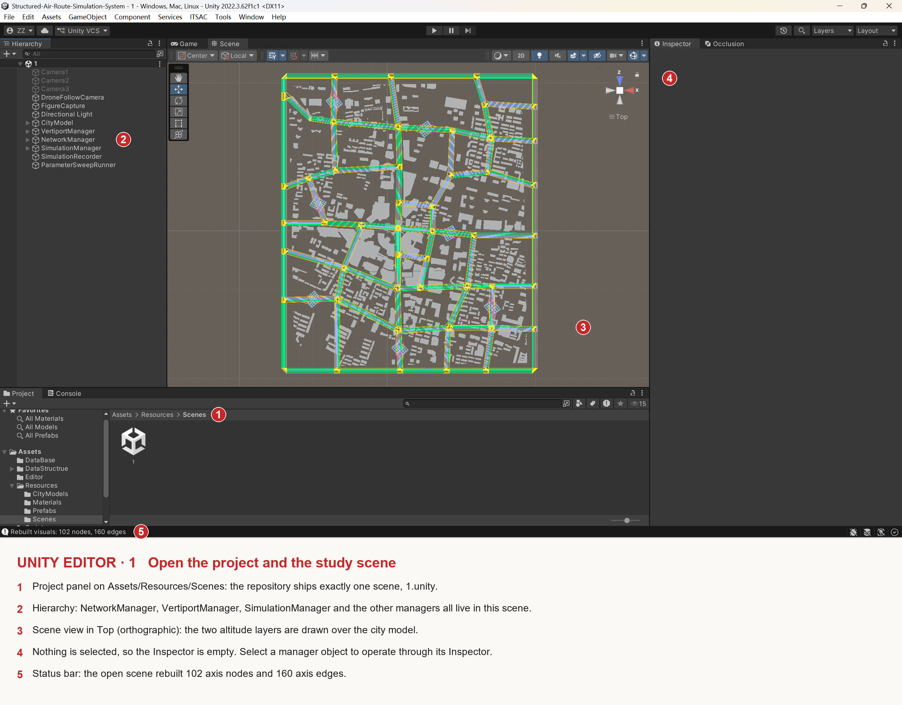

The shipped scene (`1.unity`, the Xinjiekou study area) contains these manager objects:

- `NetworkManager` — altitude layers, nodes, edges, waypoints, and derived lanes;
- `VertiportManager` — vertiports, helipads, approaches, holding structures, and corridors;
- `SimulationManager` — routes, traffic demand, single-run controls, and the joint-simulation toggle;
- `SimulationRecorder` — trajectory and metrics capture; and
- `ParameterSweepRunner` — batch experiments.

The status bar reads `Rebuilt visuals: 102 nodes, 160 edges` once the scene has finished loading, which is the quickest confirmation that the topology exported with the scene is intact.

`Tools > SAR Workbench` is an optional overview and shortcut window with five tabs (`Overview`, `Simulation`, `Network`, `Facilities`, `Build`). It is not required for the Editor workflow.

### A2. Edit the air-route network

1. Select `NetworkManager`.
2. In **Multilayer Network → Altitude Layers (n)**, press `Edit` on the layer you want to work on. Only one layer is editable at a time; the active row is highlighted and its fields are unlocked.
3. Choose an entry in **Edit Mode** (`Select`, `Create Node`, `Create Edge`, `Create Waypoint`) and edit in the Scene view. The shipped scene has two authored layers, `Lower Network Layer` at 75 m and `Upper Network Layer` at 125 m.
4. Use the row's `Visible` toggle to combine per-layer visibility with the global `Show Full Network` switch. A layer is drawn only when both are on.
5. Use the `Editable` / `Frozen` toggle to protect a layer. A frozen layer cannot be edited, renamed, moved, deleted, or reordered, and no other layer can be reordered across it. `Clear Axis Network`, JSON import, and `Add Altitude Layer` are also disabled while any layer is frozen.
6. `Lane Connections (n)` lists the authored interlayer corridors. The shipped scene has two, joining the 75 m and 125 m networks.
7. After changing axis geometry, run **Rebuild Visuals from Data** and regenerate the derived lanes. An edge receives no lanes when the building clearance cannot support at least two lanes.
8. Export the authoritative network with **File Operations → Export Axis Network to JSON**; use `Import Axis Network from JSON` to load one back.

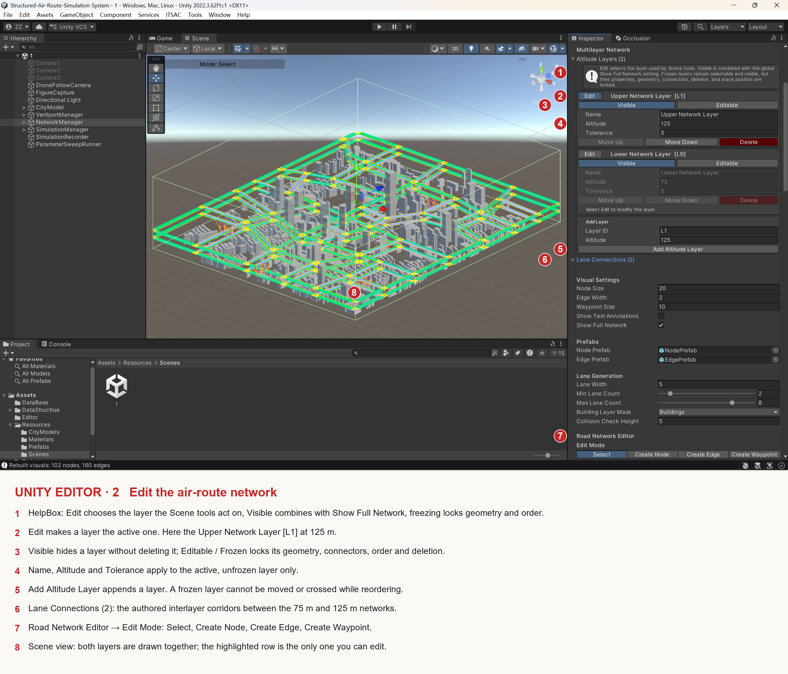

Layer names are free text and are displayed verbatim, so a renamed layer keeps its own label everywhere it appears.

### A3. Edit vertiports and supporting structures

1. Select `VertiportManager`.
2. Pick a tool from the **Edit Mode** grid. The nine modes are `Select`, `Vertiport`, `Helipad`, `Holding`, `Ring`, `Vertex`, `Ramp`, `Approach`, and `Corridor`; each has its own parameters and its own Scene-view inspection rules.
3. Carry out the steps in the order the section asks for. Creating a vertiport, for example, asks for boundary points first and only reveals the helipad, approach, and corridor tools once the boundary is finished.
4. Use **Vertiport Data → Vertiports (n)** to expand a facility and inspect its helipads, approach nodes and edges, holding structures, ramps, and corridors, or to focus an object in the view.
5. Export the facility data after validation.

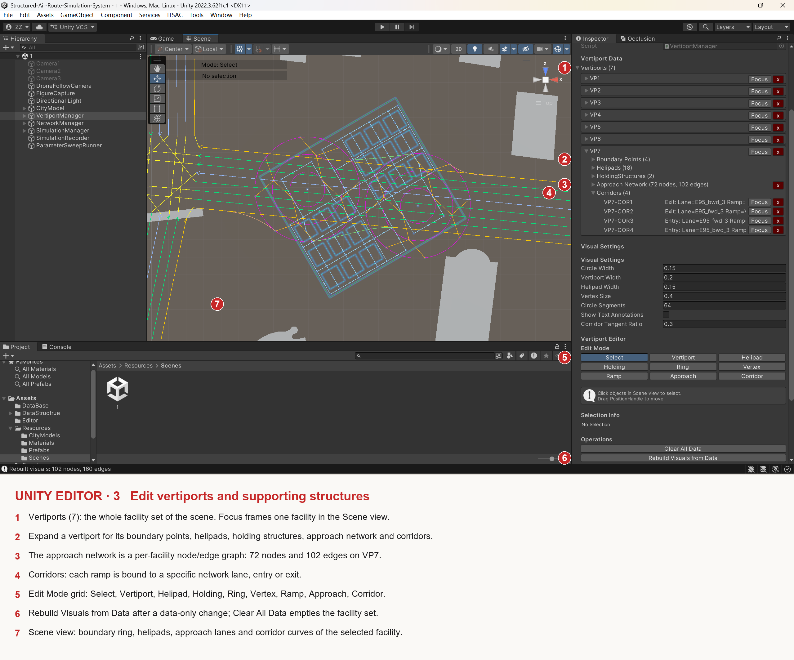

The shipped scene has seven vertiports and 126 helipads. Each vertiport owns its own approach graph — VP7 in the figure carries 72 approach nodes and 102 edges — and every corridor binds one ramp to a specific network lane as an entry or an exit.

Top view is the default for all four authoring modes, because it keeps plan coordinates unambiguous; `F` and the orientation cube still let you inspect the vertical relationships in free 3D.

### A4. Configure simulation parameters

1. Select `Assets/DataBase/DefaultSimulationConfig.asset`.
2. Set the aircraft-dynamics, following, lane-change, reservation, traffic-control, information-delay, positioning-error, and run-limit values.
3. Keep every value inside the range reported by the Inspector validation messages. The lane-change removal timeout, for example, must stay above the reroute timeout.
4. Apply changes only while no single run and no batch experiment is active. The packaged workbench and the Unity Editor read the same asset, so a change here is a change there.

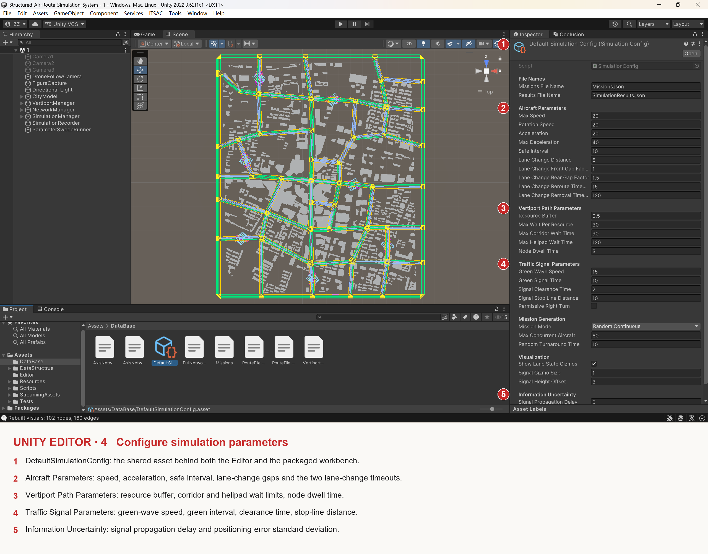

The figure shows the four groups that matter most for reproducing a published run: `Aircraft Parameters`, `Vertiport Path Parameters`, `Traffic Signal Parameters`, and (`Information Uncertainty`, at the bottom) the signal-propagation delay and positioning-error standard deviation that the sensitivity experiments sweep.

### A5. Create routes and start a single simulation

1. Select `SimulationManager` and set **Mission Mode** to `JSON File`. Route authoring is disabled in `Random Continuous` mode.
2. Expand **Routes & Traffic Flow (Inspector + Scene view)** and press `Refresh route-authoring topology` after any network or facility change.
3. Pick the origin and destination helipads.
4. Choose `Automatic shortest` and press `Generate / refresh shortest route`, or choose `Manual: click centerlines`, press `Select centerlines in Scene view`, then click axis centerlines directly in the Scene view. The first departure edge is inserted and locked automatically; each further click is checked for lane-level connectivity; clicking an already selected centerline rolls the route back to that position; `Reset to locked first edge` starts over.
5. Confirm the highlighted route with `Confirm manual route` (manual mode only). The summary box lists the ordered axis edges and the resolved lane/corridor segments.
6. Set the task ID prefix, departure time, and priority, then press `Add single mission`. Use **Periodic traffic flow** below it for a fixed-interval flow defined by aircraft count, interval, and start time.
7. Review the queue in **Mission Queue**; `Edit` loads a pending mission back into the authoring controls, `X` removes it, and `Save to JSON` writes the queue out.
8. Under **Play Control**, `Auto Start` decides whether the run begins as soon as Play Mode loads. `Enter Play Mode & Start` saves the queue, enters Play Mode, and starts the run in one step.
9. While a run is active, `Simulation Control` offers start/stop and pause/resume, and the Inspector shows aircraft, queue, and lane counts plus the metric block.

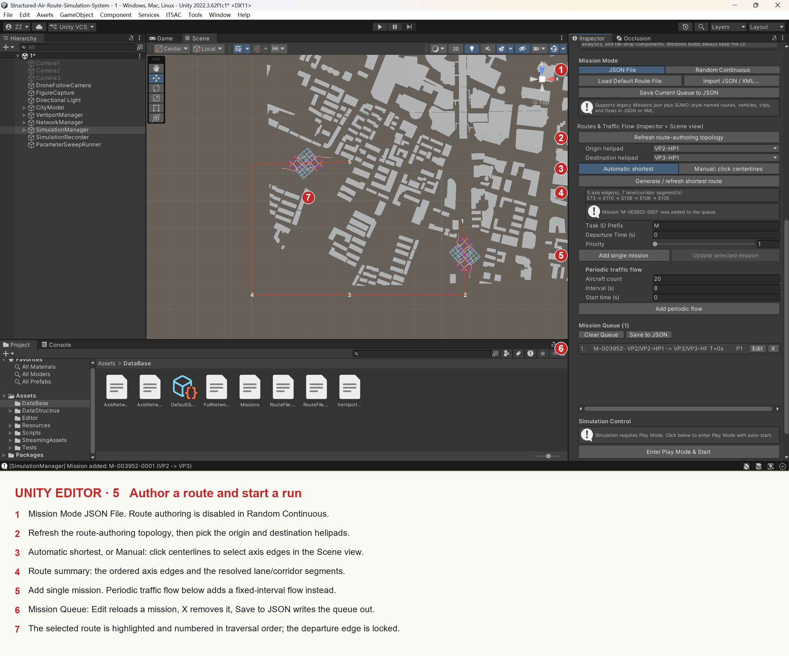

Manual selections are highlighted and numbered in traversal order. The same resolver checks connectivity and inserts the required lane changes and interlayer connectors in both workflows.

### A6. Run a parameter sweep

1. Select `ParameterSweepRunner`.
2. Under **Independent Variables**, press `+ Add Variable` and pick a field from the shared parameter catalog. Set the start value, step, and number of values for each variable.
3. Leave `Duration per Batch (s)` and the results-table output path at their defaults unless the experiment needs otherwise.
4. Read the **Grid** block: it lists each variable's resolved range and the total batch count with an estimated runtime.
5. Press `START SWEEP`. Starting outside Play Mode enters Play Mode and continues after the domain reload.
6. Press `STOP` to end early. The runner validates every range before the first batch, writes results incrementally, and restores the pre-sweep configuration when the sweep stops or completes.

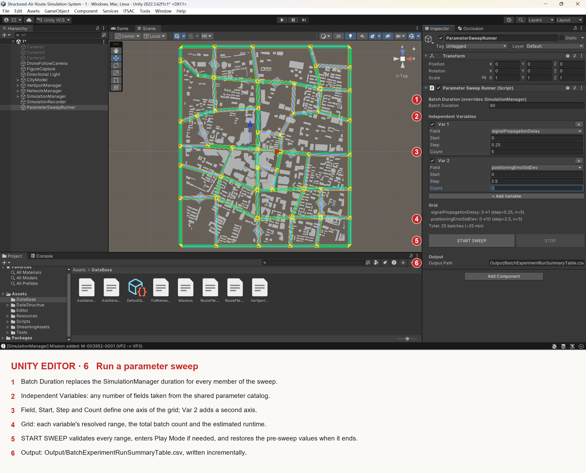

The two-variable grid in the figure — `signalPropagationDelay` over 0→1 m in 0.25 m steps and `positioningErrorStdDev` over 0→10 m in 2.5 m steps — is 25 batches, which is the shape of the parameter-response figures the workbench produces afterward.

### A7. Joint simulation with Unreal Engine and AirSim

This step is optional and needs Unreal Engine 4.27, the AirSim 1.8.1 plugin, and a Python interpreter with the `airsim` package. The Unity project is the only source of motion; AirSim receives poses and does not simulate flight.

This module is an experimental pilot. Pose streaming, automatic vehicle creation, and the follow camera work; reading AirSim state back into Unity and closing a coordination loop over it are not implemented. See the joint-simulation status table in the top-level README before relying on it.

The Unreal side is the project under `UnrealHost/SZ_TestArea/`. It needs the AirSim plugin, which is not redistributed — install AirSim 1.8.1 under `Plugins/AirSim` first. The Shenzhen whitebox scene the map was built from is published separately; see `EXTERNAL_ASSETS.md`.

1. Copy `JointSimulation/settings.example.json` to `Documents/AirSim/settings.json` on the Unreal machine. Keep `"ViewMode": "Manual"` and keep `OriginGeopoint` unchanged.
2. Install the Python client: `pip install airsim==1.8.1`.
3. In the `SimulationManager` Inspector under **Play Control**, tick `Start Joint AirSim Simulation`. The HelpBox that appears repeats the hotkeys and the two path settings.
4. Either add an `AirSimJointBridge` component to the `SimulationManager` object and fill in `pythonPathOverride` and `workingDirectoryOverride`, or set the environment variables `SAR_BRIDGE_PYTHON` (interpreter) and `SAR_BRIDGE_WORKDIR` (folder containing `airsim_bridge`). Set `UE4EDITOR_EXE` and `UE4_PROJECT` as well if the bridge should launch Unreal itself.
5. Start the simulation. The bridge process starts with the run, not with Play Mode, and is killed when the run stops. Its console reports the connected AirSim instance, the number of frames, and the followed aircraft.
6. With the Unreal window focused, use `H` to toggle follow and free-flight, `N` to cycle the followed aircraft, `J`/`L` to move the camera closer or farther, and `U`/`O` to raise or lower it.

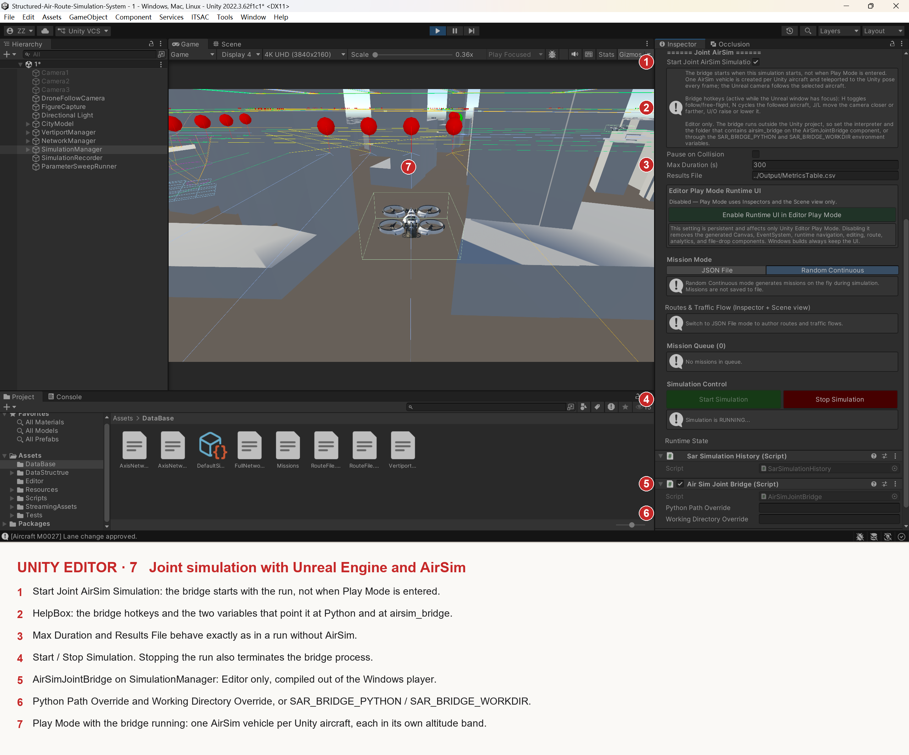

The toggle and the components it needs are all on `SimulationManager`: the checkbox under `Play Control`, and the `AirSimJointBridge` component below with its two path overrides. The screenshot shows a run in progress, so `Stop Simulation` is red and the status line reads `Simulation is RUNNING...`.

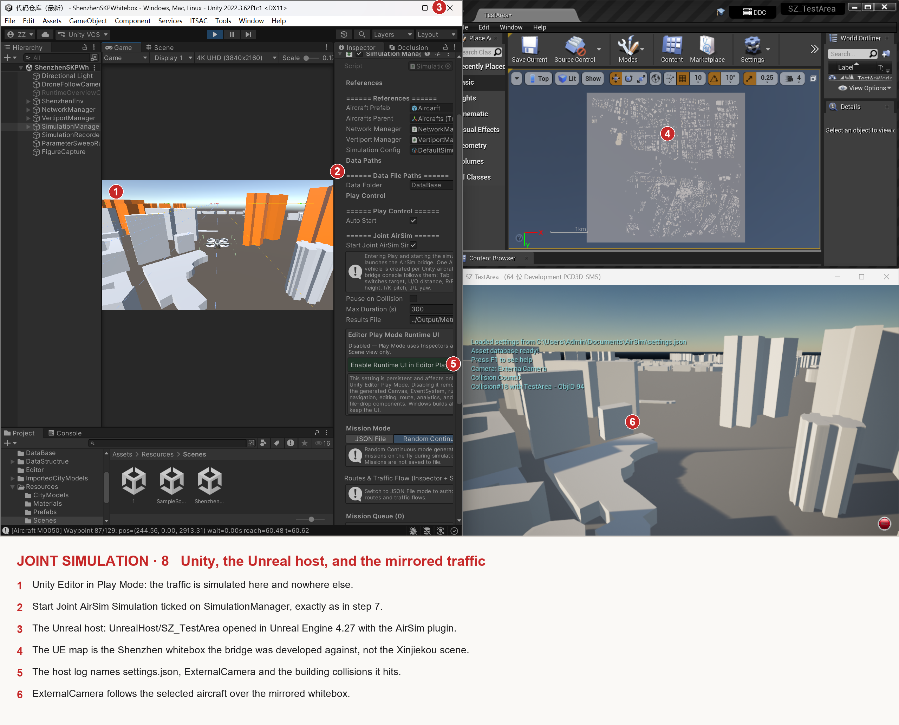

With both sides up, Unity simulates and Unreal renders. The Unreal window on the right is `SZ_TestArea`, the Shenzhen whitebox the bridge was developed against — its map does not match the Xinjiekou geometry, which is why reproducing the published demonstration needs the Shenzhen scene from `EXTERNAL_ASSETS.md`. Note the host console line `Camera: ExternalCamera`: that actor is what `simSetObjectPose` drives, and the bridge warns if it is missing.

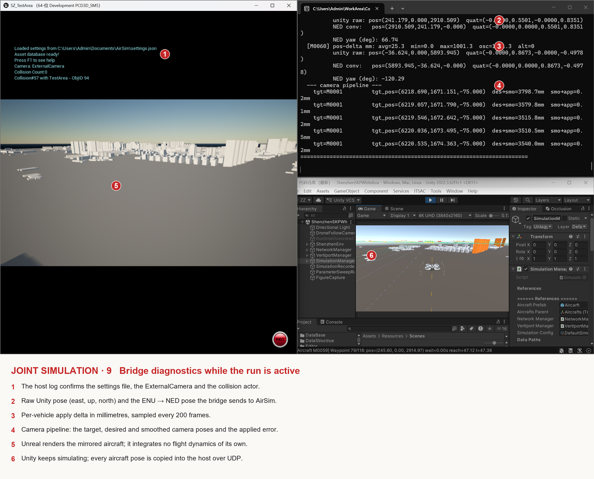

The bridge console prints one block per diagnosed frame. `unity raw` is the pose as Unity reports it (east, up, north); `NED conv` is the same pose after the ENU → NED conversion the bridge sends to AirSim. The `pos-delta mm` line is the gap between the requested and the achieved pose, and the `camera pipeline` block shows the target, desired and smoothed camera positions. These lines are diagnostics, not results: nothing in them feeds back into the traffic model.

If the bridge cannot start, the Console names the missing path — a wrong interpreter or a wrong bridge folder is reported separately, so check that message before anything else. A per-frame `bridge_diag.csv` is written beside the bridge source for offline inspection.

The joint-simulation code is compiled out of the Windows player (`#if UNITY_EDITOR`), so the packaged application has no such toggle and never needs AirSim installed.

## B. Packaged Windows workflow

The packaged application ships in two archives that differ only in the executable-adjacent `SAR.locale.json`. Every control therefore has an English label and a Chinese label, and this guide gives both as `English label (中文标签)`. Source names, altitude-layer names, and object identifiers are never translated.

### B1. Start the portable application and open a scenario

1. Extract the complete Windows x64 archive to a writable directory.
2. Keep the executable, its `_Data` directory, and all supplied folders together.
3. Start `Structured-Air-Route-Simulator.exe`.
4. Use the scenario tab row to create, open, duplicate, rename, or save a scenario. The `＋ New Scene` and `Scene Data (场景数据)` buttons sit at the right of the tab row; the Chinese build labels the first one ＋ 新建场景.

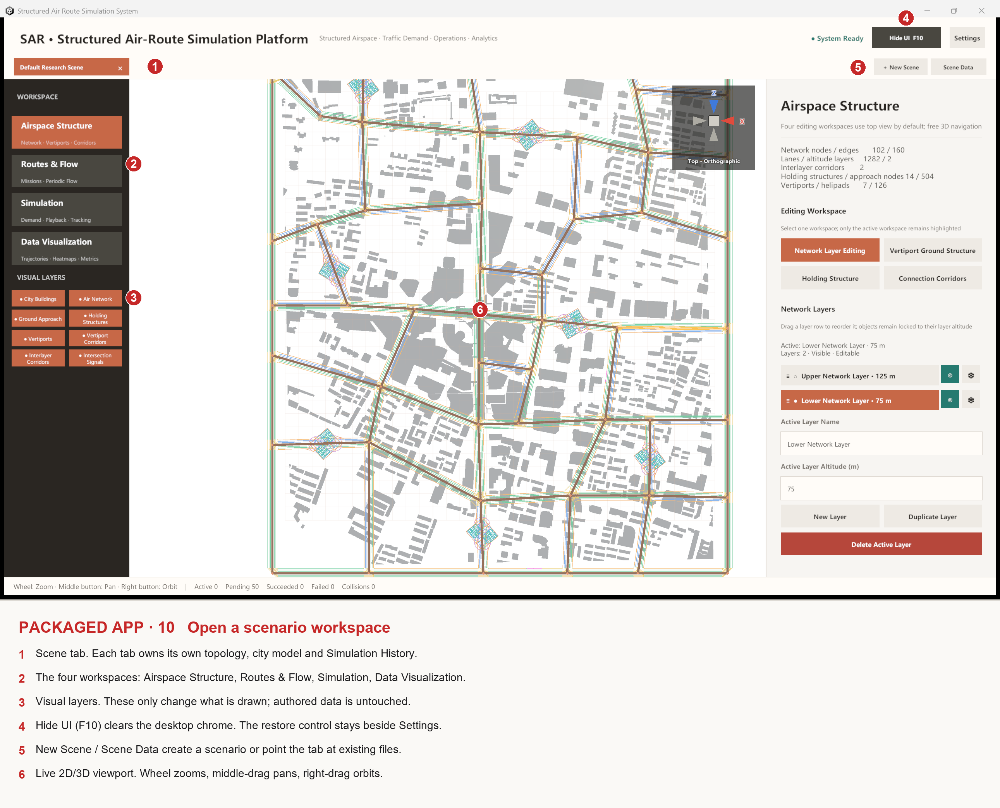

Each scenario tab owns its city model, topology, facilities, and Simulation History. Switching tabs switches both the editable environment and the records available for analysis. The status bar under the viewport reports wheel-zoom, middle-drag pan, and right-drag orbit, followed by the live mission counters.

### B2. Edit airspace structure and layer state

1. Open `Airspace Structure (空域结构编辑)`.
2. Choose one of the four editing workspaces: `Network Layer Editing (路网图层编辑)`, `Vertiport Ground Structure (起降场地面结构)`, `Holding Structure (等待结构)`, or `Connection Corridors (连接走廊)`. Only one is active at a time; the active one stays highlighted.
3. Work on an altitude-layer row in `Network Layers (路网图层)`: the eye control shows or hides that layer, the snowflake freezes or unlocks editing for it, and unlocked rows can be dragged to reorder the stack.
4. Set the active layer's `Active Layer Name (当前图层名称)` and `Active Layer Altitude (m)` (labelled 当前图层高度（米） in the Chinese build), then use `New Layer (新建图层)`, `Duplicate Layer (复制图层)`, and `Delete Active Layer (删除当前图层)` for the layer itself.
5. Use `Building-Height Aid (建筑高度辅助)` to highlight buildings above a threshold; the same height data feeds the lane-clearance check.
6. Save the scenario when done.

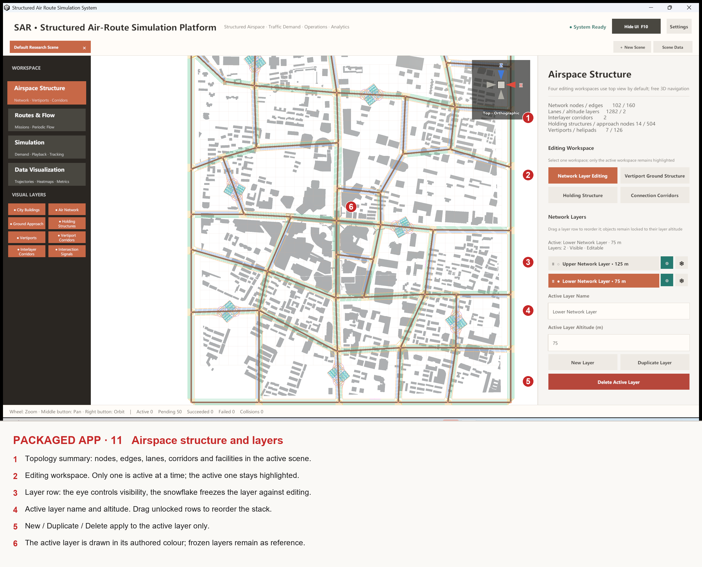

Effective layer visibility is `Air Network global visibility AND layer eye`. A frozen layer cannot be edited, renamed, moved, deleted, or crossed while reordering. Layer labels always show the authored name verbatim — never a hard-coded lower/upper pair — so a renamed layer stays recognisable in every module.

### B3. Create routes and traffic flow

1. Open `Routes & Flow (路径与交通流)`.
2. Choose origin and destination helipads in `Mission Endpoints (任务端点)`, then use `Automatic Shortest Path (自动最短路径)` or switch to `Edit Route Manually (手动编辑路径)` and click network centerlines in the viewport.
3. In manual mode the selected route is numbered in traversal order and the departure edge is locked. Clicking an already selected edge rolls the route back to it; `Confirm Manual Route (确认手动路径)` accepts the result.
4. Add a `Single-Aircraft Mission (单机任务)` or a `Fixed-Interval Traffic Flow (等间隔交通流)`.
5. Review, edit, remove, import, or export records in `Mission and Traffic-Flow List (任务与交通流列表)` and `Route-File Workspace (路径文件工作区)`.

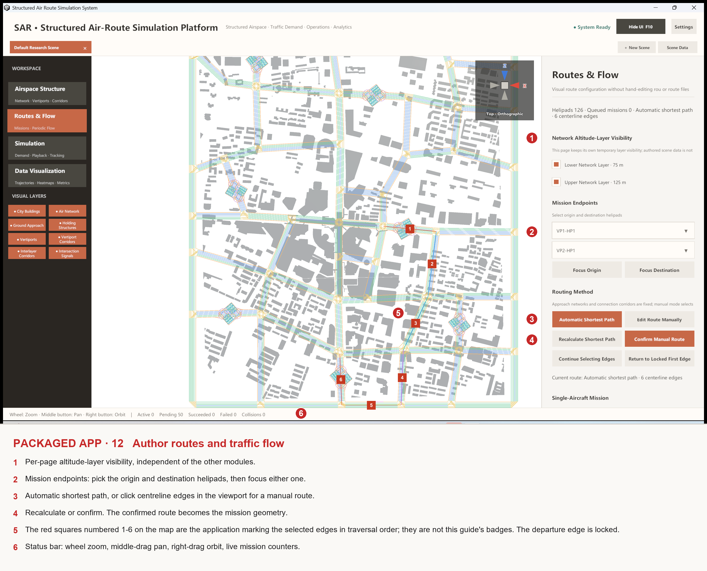

Centerline selection, highlighting, connectivity checks, route resolution, and mission formats are identical to the Unity `SimulationManager` workflow. This page keeps its own altitude-layer visibility list, so hiding a layer here does not change the authored scene.

The application numbers the selected edges on the map itself, in small red squares, in traversal order. Those squares belong to the map, not to this guide; the guide's own badges are the larger red discs with a white outline, and every one of them has a matching entry in the legend.

### B4. Run single and batch experiments

1. Open `Simulation (仿真运行)`.
2. Choose a `Demand Source (需求来源)`: JSON/XML routes or continuous random demand. Then expand only the parameter categories you need under `Parameter Controls (参数控制)` — `Aircraft Dynamics (飞行器动力学)`, `Reservation System (预约系统)`, `Traffic Control (交通管制)`, `Information Uncertainty (信息不确定性)`.
3. Press `Apply All Parameters (应用全部参数)` to commit the edits; `Reload Current Values (重新载入当前值)` discards unapplied edits. Parameters are applied only while no run is active.
4. Use `Run Controls (运行控制)` for start, stop, pause/resume, and time scale. `Runtime Lane Coloring (运行时车道配色)` offers exactly one active mode at a time.
5. For a batch, add factors under `Batch Experiments (批量实验)`, set each factor's start value, step, and value count, then press `Start Batch Experiment (开始批量实验)`. The Cartesian grid is validated before the first run.
6. Wait for the current run to stop before changing topology or applying another parameter set.

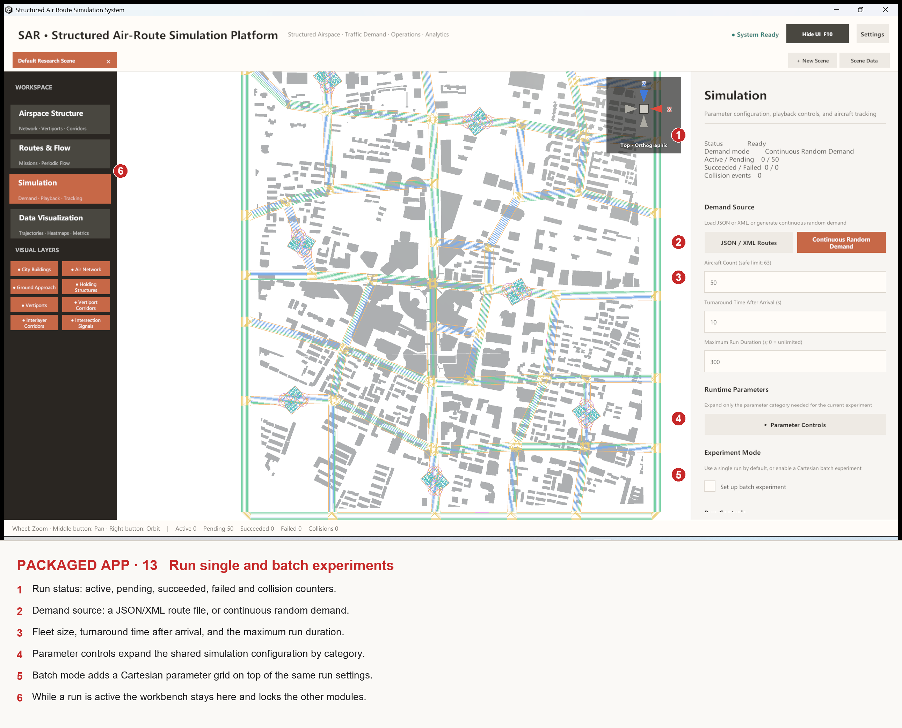

During a single run or parameter sweep the workbench stays on this page and locks the other three modules, the scene tabs, scene creation, and scene-data replacement. That interlock prevents authoring data or another scene from replacing objects the running simulation depends on. Stop the run to release it.

### B5. Review history, tables, and comparisons

1. Open `Data Visualization (数据可视化)`. The summary at the top reports completed missions, collisions, and mean flight time for the active scene.
2. In `Simulation History for the Current Scene (当前场景的仿真历史)`, select exactly one concrete run — or expand a batch and select one member — and press `Load 3D Results (载入三维结果)`. The archived topology, lane-traversal heatmap, ground-resource reservation heatmap, and downsampled completed-mission trajectories are staged first and then replace the previous overlay atomically. Aircraft still in flight when the run ended are not drawn.
3. Press `Review Result Table (查看结果表)` for that run's `MetricsTable.csv`. Selecting the batch parent itself shows its original `BatchExperimentRunSummaryTable.csv` one experiment per page in a two-column view, with `Previous Page (上一页)`, `Next Page (下一页)`, and a page-number jump.
4. Under `Analysis Variables (分析变量)`, pick one or more output metrics (`Output Metrics (Y)`, 输出指标（Y）) for a bar comparison. The selected experiment records form the X axis, so no input parameter is needed.
5. For empirical parameter-response analysis, pick one to three varying input parameters (`Input Parameters (X)`, 输入参数（X）): one X gives response curves, two give square annotated heatmaps, and three stack semi-transparent heatmap planes at the tested levels of the third parameter.
6. `Zoom In (放大)`, `Zoom Out (缩小)`, `Reset View (重置视图)`, and `Export Image (导出图片)` act on the open figure or table. `Traffic-Heatmap Altitude Layers (交通热力图高度层)` chooses which authored layers appear in the archived 3D overlay and in the Python 2D figure.

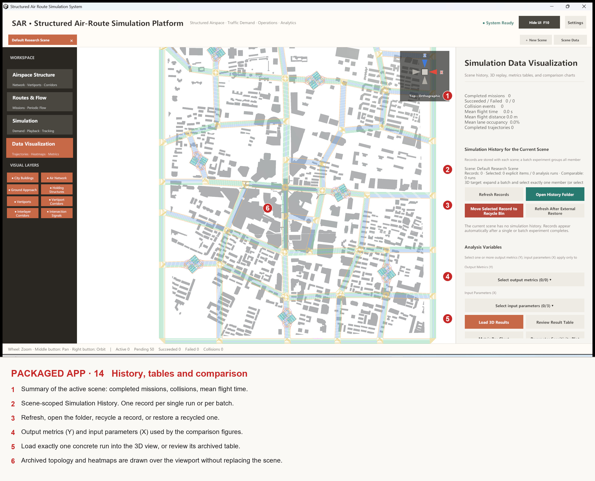

Loading archived results never replaces the scenario topology being edited. A batch parent has no unique 3D state, so it can be opened as a table or used for statistics but is never loaded as a bulk 3D overlay. `Move Selected Record to Recycle Bin (将所选记录移入回收区)` moves one standalone record or one whole batch to `SimulationHistory/.Trash/`; restore it manually and press `Refresh After External Restore (外部恢复后刷新)`.

## C. Common completion checklist

For either workflow:

1. save the active scenario;
2. rebuild and validate the derived lane network after topology changes;
3. verify routes and pending demand;
4. verify the simulation or sweep parameters;
5. run the experiment and confirm its status in the scene-scoped history;
6. inspect the 3D, table, or comparison result; and
7. keep the complete result directory when sharing an experiment.

For data formats, controls, detailed behavior, the joint-simulation reference, and Windows builds, continue with the [SAR Workbench and Windows Build Guide](../WorkbenchAndBuild.md), [Route File Format](../RouteFileFormat.md), and [Traffic Control, Lane Change, and Deadlock Rules](../TrafficControl.md).
